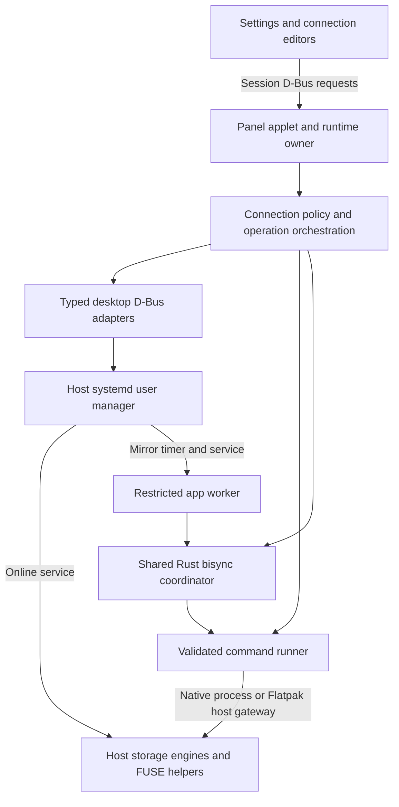
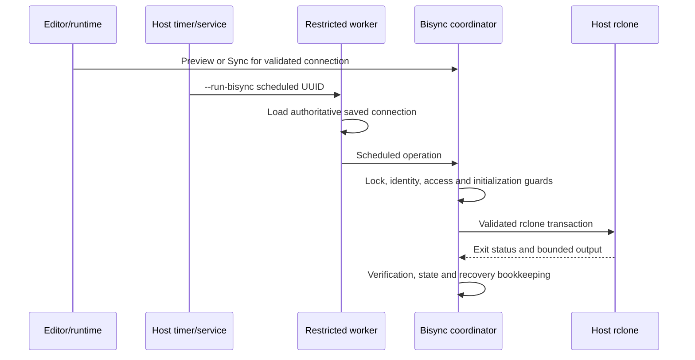

# Cloud Mounter design

Type: Design and source architecture guide

Created and last reviewed: October 22, 2026

Audience: Software engineers maintaining the applet or reviewing its host integration.

Scope: The Rust application, Online mounting, Offline mirroring, native/Flatpak
execution and supporting desktop services. This document describes the source
structure and design choices; it does not certify every provider or deployment
scenario. It is placed at the repository root at the operator's request.

## 1. Purpose and architectural boundaries

Cloud Mounter manages connections to OneDrive, SharePoint document libraries,
Google Drive, Box, SMB and SFTP. It supplies configuration, validation, scheduling,
safety policy and desktop controls. External storage engines implement the remote
protocols and data transfer. There is no Cloud Mounter relay server.

The two storage modes solve different problems:

| Mode | Storage model | Engine | Lifetime |
|---|---|---|---|
| Online mount | A host FUSE filesystem, with files fetched on demand and engine-managed caching | onedriver for OneDrive; rclone mount for the other providers | Host systemd user service |
| Offline mirror | An ordinary local directory synchronized bidirectionally with a remote folder | rclone bisync for supported providers | Explicit manual transaction or host systemd timer invoking an app worker |

An Online cache is not an Offline mirror. An Offline directory remains an
ordinary local directory when synchronization stops. Mount and mirror targets
must not be substituted for one another or overlap unsafely.

The diagram shows responsibility and execution boundaries, not a strict module
dependency graph. `app.rs` is a substantial integration layer rather than a
fully separated presentation-only view. Library modules hold reusable plans,
adapters and safety policy; the binary owns GUI and cross-window IPC wiring.

## 2. Processes, ownership and saved state

### One executable, several entry points

`main.rs` dispatches restricted worker and service-guard arguments before
starting a GUI. The normal launch joins the COSMIC panel. Standalone modes open
Settings, Add/Modify, reorder or import windows through the same `AppModel`.
The scheduled worker runs without a GUI or a panel runtime owner.

The panel owns shared interactive runtime state: running operations, observations,
sleep coordination and operation completions. Standalone windows request runtime
operations through session D-Bus. Settings also owns an activation interface so
another Settings request can focus the existing window. Long work is dispatched
as asynchronous tasks; the IPC method queues a request instead of executing an
engine transaction inside the D-Bus handler.

`runtime_ipc.rs` defines typed Rust commands and responses, serialized as JSON
inside D-Bus requests. This is an application protocol, not a generic command
execution interface. Important names are:

| Role | D-Bus name |
|---|---|
| Runtime owner | `io.github.uutzinger.cosmic-ext-applet-mounter.Runtime` |
| Settings activation | `io.github.uutzinger.cosmic-ext-applet-mounter.Settings` |

Requests have bounded waits. Startup/reconnection handling lets Settings survive
panel replacement; a communication failure is shown rather than assuming an
operation succeeded. Completion revisions distinguish new results from old ones.

### Configuration versus observation

`model.rs` defines connection UUIDs, providers, mode-specific options, identities,
VPN associations, operations and statuses. `config.rs` persists a versioned
configuration document through COSMIC configuration storage, with validation,
compatibility handling and a host-visible storage path for sandboxed/runtime use.
Connection names are presentation; UUIDs bind units and operation state.

Saved configuration describes intent. Unit properties, mount observations,
coordinator results and engine health describe current behavior. A timer being
active means scheduling is enabled, not that the previous synchronization passed.
A failed Preview can coexist with an off schedule toggle.

`controller.rs` derives rows and available actions from snapshots. It is separate
from performing operations. The application retains last-known observations on
refresh failure, with freshness checks that prevent stale state authorizing an
unsafe action. Missing retired services are distinguished from failed reads or
missing supported services.

## 3. Online mount lifecycle

1. The editor builds a draft, selects or creates an engine remote and tests its
   access. Successful tests are associated with the tested inputs; relevant edits
   invalidate them. Saving a draft does not establish that a mount is running.
2. Provider planning validates the remote, mountpoint, cache options and required
   provider identity. The plan supplies a systemd service and pre-start guard.
3. The app checks network/VPN readiness and mount ownership. A service guard also
   protects a direct systemd start, including protection against covering existing
   local files with a new mount.
4. The user manager starts the host engine. The app reads back systemd and actual
   mount state rather than treating a successful start request as final readiness.
5. Optional directory preload runs after mounting. Unmount, Repair, removal or
   sleep cleanup cancels preload before detaching the mount.
6. Clean detach and service stop follow ownership and engine-health policy.
   Lazy detach is a separate confirmed recovery operation, not a default unmount.

For rclone, `providers.rs` creates a VFS mount with full caching, bounded cache
settings and a per-connection RC Unix socket. RC calls provide readiness,
upload/cache health, pending counts and directory refresh. The socket is local
to the user runtime rather than a public network RC endpoint. Mount arguments
include `--rc-no-auth`; access therefore depends on the local socket boundary.
Engine configuration and path validation remain important even without a TCP port.

Google Drive enables `--fast-list` when the VFS is created. Its preload first
refreshes the root nonrecursively, then requests recursive refresh under the same
deadline. VFS refresh jobs are asynchronous, tracked and cancellable. Other
providers use bounded directory walks with provider-specific limits/exclusions.
Preload warms metadata, not file contents, and can consume provider API quota.

OneDrive Online uses onedriver's own configuration/cache and mount service.
SharePoint adds verified library identity guards and provider-specific upload
settings. There is deliberately no universal set of rclone flags for every
provider; the authoritative launch options are in `providers.rs`.

## 4. Offline mirror lifecycle

### One coordinator for manual and scheduled work

`sync.rs` validates mirror inputs and constructs an `RcloneBisyncPlan` with remote
and local targets, filters, service/timer definitions, work state and recovery
policy. `bisync_coordinator.rs` executes the transaction for InitialPreview,
Preview, InitialSync, Sync and Scheduled modes. Manual UI requests and the worker
enter that same coordinator, so timers do not implement a second synchronization
algorithm.

The two entry paths in the diagram are alternatives; they must not run
concurrently for one connection. A per-connection nonblocking OS file lock
serializes coordinator mutation across processes. In-process operation controls
add cancellation/completion coordination. `offline_coordinator.rs` supplies
atomic structured operation state; it is not a second engine implementation.

### Initialization and transaction safeguards

New mirrors are saved with scheduling paused. InitialPreview must succeed before
the confirmed InitialSync. Normal Sync and Scheduled modes require initialization
markers; changing a target must not accidentally reuse an unrelated baseline.
Preview is a dry run and does not transfer user files, but may prepare app-owned
state, filters and markers. It is not an entirely mutation-free operation.

The coordinator acquires its lock before preparing shared inputs, verifies
provider binding where required, resolves authorized local paths and validates
access/ownership markers. It prepares scoped local/remote recovery destinations,
runs rclone with fixed arguments and applies the plan's verification policy.
Some provider plans include convergence/checksum steps; engine exit success is
not universally sufficient to initialize a mirror. Verification and recovery
cleanup can report distinct failures or warnings.

Bisync propagates changes and deletions in both directions. Recovery and conflict
handling reduce the consequences of unintended changes; they do not replace an
independent backup or coordinate simultaneous multi-user document editing.
Retention cleanup acts only on eligible app-owned recovery records. Google-native
document types and recovery directories use provider/target-specific filters.
Repair pauses services and preserves safety/recovery state; it is not permission
to discard the baseline or run an unconditional destructive resync.

### Scheduled execution

`mirror_script.rs` constructs service specifications; despite its name it does
not generate a bisync shell script. `bisync_worker.rs` accepts only a supported
operation and UUID, reloads the saved configuration and reconstructs paths and
arguments. A caller cannot supply an executable, shell command or replacement
remote path through worker arguments.

The systemd timer uses `OnActiveSec` for the first delay and `OnUnitInactiveSec`
for the interval after a background run finishes. The default mirror interval is
15 minutes. Sync Now bypasses the timer delay. Generated service conditions check
readiness/metered policy and provider guards as applicable. Structured progress
is associated with the service invocation so an earlier run is not mistaken for
current activity.

## 5. Host interaction and Flatpak boundary

Native and Flatpak editions share policy and engine plans. Transport and path
resolution differ. They share host-visible connection/service state, so they
must not run competing interactive runtime owners.

| Operation | Mechanism | Why this boundary is used |
|---|---|---|
| User service/timer management | systemd user manager on session D-Bus | Structured start/stop/enable/status/job results and owned-unit lifecycle |
| Network/VPN discovery and control | NetworkManager on system D-Bus | Saved profile identity, observed state and shared-VPN ownership decisions |
| Sleep preparation | logind on system D-Bus | PrepareForSleep events and delay-inhibitor lifetime |
| Folder selection and URL opening | Desktop portals | User-mediated selection and desktop/sandbox integration |
| Storage engines/FUSE helpers | Native child processes or `flatpak-spawn --host` | Host-visible mounts, engine configuration and host storage paths |
| Scheduled Flatpak worker | Host user service launches fixed `flatpak run --command=...` entry | Worker runs in the app sandbox while rclone operates on host paths |
| Limited host inspection | Fixed host runner operations | Host mount namespace differs from sandbox observations |

`process.rs` centralizes fixed executable identities, arguments, timeouts,
bounded output, redaction and cancellation/child cleanup. Its `CommandRunner`
trait has native, Flatpak and fake implementations. `host_inspection.rs` exposes
only fixed read-only requests, including remote configuration discovery and host
mountinfo. Captured raw configuration is not handed to the UI as a diagnostic.

The Flatpak permission to talk to `org.freedesktop.Flatpak` enables broad host
execution. Application validation is not an OS-enforced per-command permission
restriction. The shipping manifest avoids blanket host filesystem and bus-socket
grants, but that does not make the host execution gateway narrowly privileged.
Review the complete built metadata, inherited BaseApp policy and installed
overrides as well as declared finish-args.

### Host paths and portal paths are different authorities

A host engine needs the original host directory. The sandboxed Rust coordinator
also needs filesystem access for markers, recovery metadata and bookkeeping.
Knowing a host path does not grant the sandbox access to it.

`mirror_access.rs` remembers and revalidates selected directory grants and
resolves a local authorized view separately from the saved host paths. Mirror
and recovery directories must each be selected through Browse in Flatpak.
Typed host-path resolution uses Documents portal APIs; the supported portal-v4
case uses a bounded host `flatpak document-info` compatibility request. General
errors on a newer interface do not trigger that fallback.

| State | Typical ownership/location |
|---|---|
| Connection document | COSMIC configuration under the app ID; host-visible document used by runtime/worker |
| Generated units | Host user systemd configuration; app-owned UUID-marked service/timer files |
| Sleep drop-ins and RC sockets | User runtime paths; transient coordination and mount control |
| Engine metadata/cache | App-scoped configuration/cache directories; engine owns authentication storage |
| Mirror locks/results/work files | App state root; Flatpak explicitly uses host-visible `~/.local/state/cosmic-ext-applet-mounter` |
| User data and recovery | Selected host folders plus separately authorized sandbox-local access |

Exact roots depend on native/Flatpak path resolution and supported XDG settings.
See `config.rs`, `providers.rs`, `mirror_access.rs` and `default_work_root` in the
coordinator rather than deriving paths from display names.

## 6. Authentication, identity and desktop coordination

Rclone and onedriver own persistent provider credentials. Setup code may handle
credentials/tokens transiently for engine configuration and Graph verification;
this does not mean the app never sees sensitive values. These values must not
enter notices, general logs or the connection document as authentication storage.

Google Drive/Box setup runs browser OAuth through rclone, verifies completion and
tests access before reporting success. A failed create may roll back only its own
initially absent remote. Existing remotes are not deleted on update failure.
Remote deletion is separately confirmed and blocks remotes used by saved
connections.

OneDrive Offline binds the expected account, drive type and primary-drive identity.
SharePoint binds the selected site/document library and optional subtree. These
bindings protect against a saved remote being repointed to a different target.
SFTP treats authentication and host verification as separate requirements;
accepting credentials must not silently disable known-host checks.

VPN policy separates profiles the app activated from pre-existing/shared usage.
Readiness combines NetworkManager state with in-process route, DNS and endpoint
checks. A connection must not disconnect a VPN another active connection needs.
OpenConnect may depend on a user-installed secret-agent service; service control
uses systemd D-Bus.

Opt-in sleep handling concerns Online mounts. It cancels/invalidate in-flight
Online operations, coordinates bounded cleanup under a logind inhibitor and can
restore eligible mounts after wake. Offline transactions have their own
cancellation/state policy. The presence of sleep code is not proof of every
active-transfer suspend/recovery scenario.

Retired abraunegg profiles remain recognizable but unsupported in 0.5.5. Startup
retires only structurally verified app-owned monitors through systemd. User data,
recovery directories and credentials are preserved; no automatic engine conversion
or restart of the retired engine is used as rollback.

## 7. Source map

This is a conceptual hierarchy, not a proposed directory reorganization. All
36 Rust source files under `src/` are listed. Library modules are exported by
`lib.rs`; binary-specific modules are declared by `main.rs`.

### Entry points, presentation and persistence

| Source | Responsibility |
|---|---|
| [src/main.rs](src/main.rs) | Dispatches worker/guard modes and starts standalone windows or the COSMIC panel applet. |
| [src/lib.rs](src/lib.rs) | Exposes backend modules for the binary, examples and integration tests; gates development-only orchestration. |
| [src/app.rs](src/app.rs) | AppModel, messages/views, drafts, setup orchestration, operation dispatch, runtime subscriptions and observation integration. Largest integration module. |
| [src/app/editor_actions.rs](src/app/editor_actions.rs) | Shared editor readiness/tone/progress policy, input/request revisions and confirmation/test invalidation. |
| [src/app/sftp.rs](src/app/sftp.rs) | SFTP editor fields, authentication selection, remote-prefill/setup and host-verification checks. |
| [src/controller.rs](src/controller.rs) | Derives connection rows, action eligibility, summaries and accessible/status labels from snapshots. |
| [src/model.rs](src/model.rs) | Domain types, stable identities, mode options, provider bindings and operation/status enums. |
| [src/config.rs](src/config.rs) | Versioned configuration, validation, persistence, compatibility and host-visible runtime storage. |
| [src/runtime_ipc.rs](src/runtime_ipc.rs) | Session D-Bus runtime request/reply and Settings activation services, subscriptions and bounded reconnection. |
| [src/i18n.rs](src/i18n.rs) | Embedded Fluent localization initialization and shared localization access. |
| [src/theme.rs](src/theme.rs) | Loads host COSMIC light/dark preferences and palette for standalone windows. |
| [src/import.rs](src/import.rs) | Parses compatible existing service definitions, previews imports and plans app-managed replacements. |

### Desktop services, process execution and observation

| Source | Responsibility |
|---|---|
| [src/services.rs](src/services.rs) | Typed service/timer specs, unit rendering/validation/storage, systemd D-Bus adapters, observations, operation locks and owned-unit retirement. |
| [src/process.rs](src/process.rs) | Executable/argument request model, native/Flatpak runners, bounded execution, redaction, cancellation and fake runner. |
| [src/host_inspection.rs](src/host_inspection.rs) | Fixed asynchronous configuration and host-mount inspection adapter with bounded private output. |
| [src/mounts.rs](src/mounts.rs) | Mountinfo parsing and mount/sync observation interfaces with fake implementations. |
| [src/mount_guard.rs](src/mount_guard.rs) | Empty-directory/mountpoint checks and restricted service pre-start guards. |
| [src/diagnostics.rs](src/diagnostics.rs) | Dependency minimums/capability inventories, availability and setup guidance. |
| [src/vpn.rs](src/vpn.rs) | NetworkManager D-Bus abstraction, activation/release policy, readiness probes and service guards. |
| [src/sleep.rs](src/sleep.rs) | logind subscriptions/inhibitor, Online operation invalidation, cleanup/drop-in coordination and wake restoration. |

### Online engines, preload and pending observations

| Source | Responsibility |
|---|---|
| [src/providers.rs](src/providers.rs) | Rclone/onedriver Online plans, remote inventory, cache/RC health, runtime classification and detach/remount policy. |
| [src/directory_preload.rs](src/directory_preload.rs) | Bounded directory-walk preload lifecycle, provider limits and cancellation. |
| [src/rclone_refresh.rs](src/rclone_refresh.rs) | Google VFS root-first/recursive async RC refresh lifecycle and cancellation. |
| [src/preload_report.rs](src/preload_report.rs) | Shared preload outcomes and report formatting. |
| [src/pending_count.rs](src/pending_count.rs) | Rclone VFS pending uploads, explicit preview counts and invocation-matched mirror progress observations. |

### Offline transactions and provider identity

| Source | Responsibility |
|---|---|
| [src/sync.rs](src/sync.rs) | Mirror plans/arguments, preview/readiness decisions, filters, status, conflict/recovery policy and records. |
| [src/bisync_coordinator.rs](src/bisync_coordinator.rs) | Shared lock-protected transaction: guard, prepare, run, verify, publish state and maintain owned recovery. |
| [src/offline_coordinator.rs](src/offline_coordinator.rs) | Cancellation/completion control and atomic durable Offline operation state. |
| [src/bisync_worker.rs](src/bisync_worker.rs) | Restricted saved-connection worker parsing, service launch specifications and coordinator entry. |
| [src/mirror_script.rs](src/mirror_script.rs) | Scheduled worker service specification and progress artifact paths; no shell-script synchronization implementation. |
| [src/mirror_access.rs](src/mirror_access.rs) | Host/portal path separation, remembered grants and sandbox-local mirror/recovery access. |
| [src/microsoft_oauth.rs](src/microsoft_oauth.rs) | Shared rclone Microsoft authorization transport and token/config access with provider-selected policy. |
| [src/onedrive.rs](src/onedrive.rs) | Primary-drive/account identity verification, Graph adapter, remote setup and mirror binding guards. |
| [src/sharepoint.rs](src/sharepoint.rs) | Library URL/Graph identity verification and Online/Offline target-binding guards. |
| [src/sharepoint_setup.rs](src/sharepoint_setup.rs) | Guided browser authorization and rclone configuration for a selected document library. |
| [src/onedrive_prototype.rs](src/onedrive_prototype.rs) | Test/development-feature scenario orchestration using production identity policy; not default runtime code. |

## 8. Engineering tradeoffs and change guidance

- External engines provide mature protocol implementations and host-visible
  storage, at the cost of host dependencies and a broad Flatpak command gateway.
- Host systemd services keep mounts/schedules independent of an open editor.
  The cost is durable unit ownership, package-aware launch paths and careful
  reconciliation of intent with actual service state.
- Shared mirror policy avoids divergent manual/timer behavior. Process locks and
  durable results are necessary because a worker may outlive a GUI process.
- Typed D-Bus/portal APIs provide structured desktop state. Engine processes
  remain behind a validated adapter because storage engines are not desktop APIs.
- A large `app.rs` makes orchestration visible in one place but couples UI and
  integration work. Preserve existing policy boundaries when extracting modules;
  do not duplicate coordinator or action-state logic in new views.
- Separate host and portal paths make sandbox access explicit. A successful
  mount or engine transfer alone does not establish local worker access.

For a new provider, first decide whether an existing engine and mode fit, define
identity/target validation, then add setup, plans, guards and tests. For a desktop
operation, choose the correct typed bus/portal adapter before adding code. For a
new host request, record the required host interaction and permission rationale.
Worker interfaces should continue to accept fixed operations and saved identities.

Tests use fake command runners, service stores/managers, Graph/readiness adapters
and temporary files; engine integration tests are separate and require explicit
disposable setup. Compilation, fake tests, real engines, installed services,
rendered UI and final package acceptance are different evidence levels.

The 0.5.5 record includes source tests, built/inspected Debian and Flatpak packages,
and scoped installed x86_64 smoke checks. Whole-root cloud, final scheduled-worker,
legacy package-upgrade and other unrun scenarios retain explicit limits. This
guide does not turn source implementation into live acceptance.

## 9. Related engineering references

- [Host interaction justifications](docs/engineering/flatpak-host-command-inventory.md#current-055-exemption-summary).
- [Submission baseline and package evidence](docs/engineering/cosmic-submission-audit.md).
- [Flatpak packaging and permission rationale](packaging/flatpak/README.md#permission-rationale).
- [OneDrive Offline contracts](docs/engineering/onedrive-rclone-offline-contracts.md).
- [Mirror Repair contracts](docs/engineering/offline-mirror-repair-contracts.md).
- [GUI action/layout inventory](docs/engineering/gui-action-layout-inventory.md).
- [Task and acceptance history](Task%20List%20Completion%20Notes.md).
