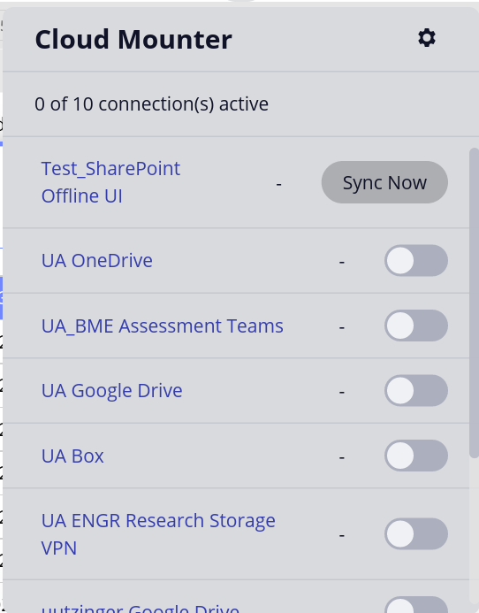
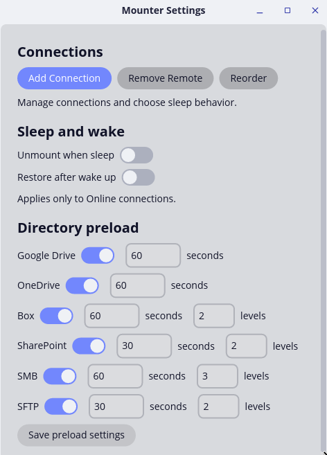
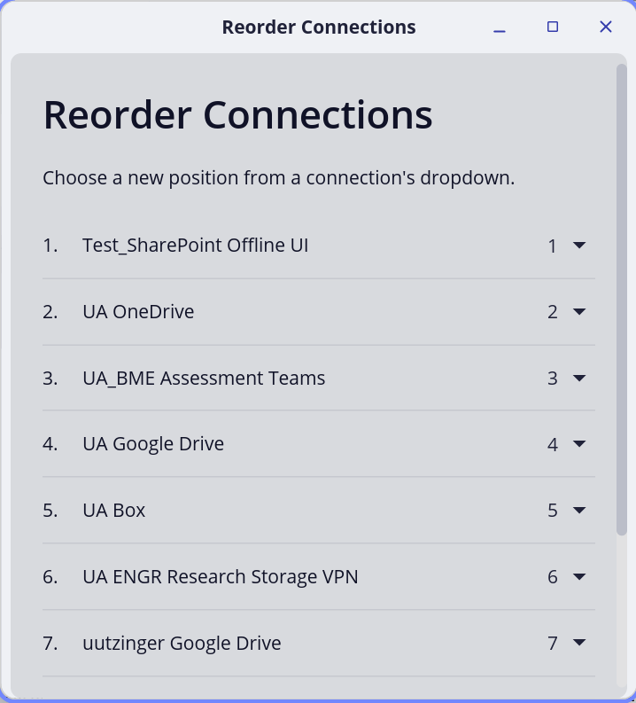
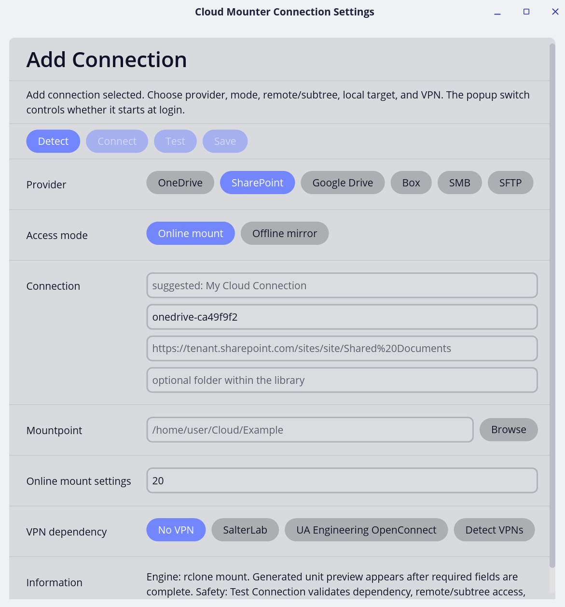
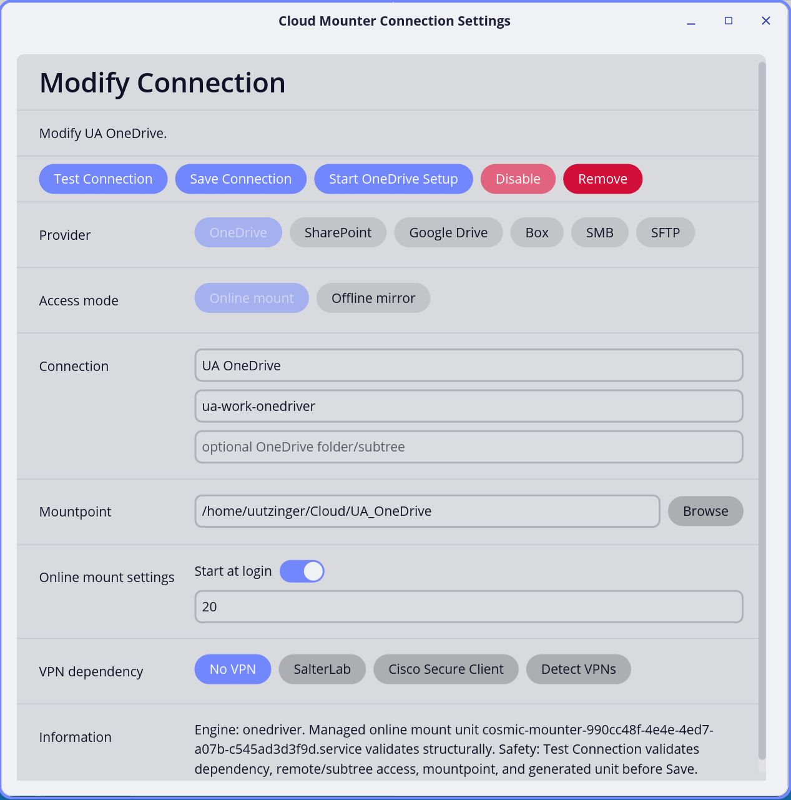

# Cloud Mounter for COSMIC™


Cloud Mounter is an applet for the COSMIC™ desktop for managing storage
connections to **OneDrive**, **SharePoint**, **Google Drive**, **Box**, **SMB**, and **SFTP**. It supports
direct **Online mount** and **Offline mirror** mode.

The applet simplifies mounting cloud storage. Users can turn storage
connections on or off to reduce file manager stalls when the network is slow or
unavailable.

Example screenshots of the applet and its separate windows:

<table>
  <tr>
    <td><a href="./resources/Popup.png" target="_blank" rel="noopener noreferrer"></a></td>
    <td>
    <a href="./resources/Settings.png" target="_blank" rel="noopener noreferrer"></a>
    <a href="./resources/Reorder_Connections.png" target="_blank" rel="noopener noreferrer"></a>
    </td>
  </tr>
  <tr>
    <td><a href="./resources/Add_Connection.png" target="_blank" rel="noopener noreferrer"></a></td>
    <td><a href="./resources/Change_Connection.png" target="_blank" rel="noopener noreferrer"></a></td>
  </tr>
</table>

## Modes and Providers

**Online mount** uses a network-backed FUSE filesystem. It is useful for browsing
large remote trees without keeping a full local copy.

**Offline mirror** uses an ordinary local directory plus bidirectional background sync.

The following connection engines are used to connect to the providers:

| Provider | Online mount | Offline mirror |
|---|---|---|
| OneDrive | [`jstaf/onedriver`](https://github.com/jstaf/onedriver) | [`rclone bisync`](https://rclone.org/) for new mirrors; legacy `abraunegg/onedrive` retained |
| Google Drive | [`rclone mount`](https://rclone.org/) | [`rclone bisync`](https://rclone.org/) |
| Box | `rclone mount` | `rclone bisync` |
| SMB | `rclone mount` | `rclone bisync` |
| SFTP | `rclone mount` | `rclone bisync` |
| SharePoint | `rclone mount` | managed `rclone bisync` schedule, disabled until explicitly started |

`jstaf/onedriver` is ideal for on-demand access to OneDrive.

> **0.5.4:** New OneDrive mirrors use rclone. Run Preview and the confirmed initial Sync Now before Start enables scheduled sync (15 minutes by default). Existing abraunegg mirrors remain supported for this release; there is no automatic conversion. See the [release notes](docs/releases/v0.5.4.md) for migration guidance and acceptance status.

New OneDrive mirrors need **rclone 1.74.3 or newer** and use the primary personal or work/school drive. In Add/Modify, choose the drive type, enter the expected account, and connect a new remote or verify an existing one. Custom Microsoft clients and alternate roots are not supported for these mirrors. SharePoint and legacy custom-client guidance is in [Microsoft cloud authentication setup](docs/microsoft-cloud-auth-setup.md).

`rclone` also supports Microsoft Teams and SharePoint document libraries.

## Data Integrity Warning

Cloud sync and mounts can delete, overwrite, duplicate, or hide files when they
are configured incorrectly. **Before testing with important data, make an
independent backup**.

To reduce data integrity risks, **do not**:

- use an Online mount point as an Offline mirror directory;
- use an Offline mirror directory as an Online mount point;
- run Online mount and Offline mirror concurrently against the
  same account or overlapping subtree unless the applet has explicitly
  isolated that setup;
- run `rclone mount`, `rclone bisync`, `onedriver`, `onedrive --sync`, or
  `onedrive --resync` directly against an applet-managed connection. Use the
  applet's Mount, Unmount, Preview, Sync Now, Start, Stop, and repair controls so
  its safety checks and synchronization state remain consistent.

## Installation

The [documentation index](docs/index.md) links to setup guides, release notes,
and engineering records.

[Release 0.5.4](https://github.com/uutzinger/cosmic-ext-applet-mounter/releases/tag/v0.5.4)
provides Debian packages and Flatpak bundles. COSMIC Flatpak repository
submission is planned for 0.5.5.

When replacing an existing installation, stop its connections, close its windows
and remove it from the panel first. Run only one native or Flatpak edition at a
time; they share saved connections and host services.

### Dependencies

Both Debian and Flatpak installations require storage engines on the host.
The dependency installer installs all supported engines, including legacy onedrive:

```sh
curl -fsSL https://raw.githubusercontent.com/uutzinger/cosmic-ext-applet-mounter/master/scripts/install-dependencies.sh | bash
```

For individual engines and VPN setup, see [Dependency installation](docs/dependency-installation.md).
The applet does not install these dependencies itself.
For a Flatpak installation, install Flatpak through your distribution first.

### Installation from Source

See [Build from Source](docs/build-from-source.md).

### Installation from GitHub Release: Debian Package

```sh
curl -fsSL https://raw.githubusercontent.com/uutzinger/cosmic-ext-applet-mounter/master/scripts/install-debian.sh | bash
```

### Installation from GitHub Release: Flatpak

```sh
curl -fsSL https://raw.githubusercontent.com/uutzinger/cosmic-ext-applet-mounter/master/scripts/install-flatpak-release.sh | bash
```

### Post Installation

After installation, open **COSMIC Settings > Desktop > Panel > Applets** and add
**Cloud Mounter** to the desired panel or dock.

In Flatpak, select mirror and recovery directories separately using their
**Browse** buttons.

## Applet Workflow

The panel popup shows a scrollable list of connections and a brief status line
when attention is needed.

Each connection row has the connection name and one primary state control:

- Online mount toggle button uses Mount or Unmount.
- Offline mirror toggle button uses Start or Stop for background synchronization.

Clicking the connection name opens `Modify` window.

The connection mounting state is persistent over login: An Online mount left
on is remounted at the next login; switching it off unmounts it and keeps it off
after reboot. Offline mirror Start and Stop likewise enable or disable the
background schedule across logins.

A small count beside the name shows pending work when an engine can estimate it;
`+` means active without a count and `-` means unknown or unavailable.

## Settings

Open the Settings window by clicking the gear icon. `Add Connection`, `Refresh`,
and `Reorder` are available under **Connections**. Add and Modify connections
share the same editor.

Add mode exposes `Test Connection`, `Save Connection`, `Import`, and the
provider-specific setup and rclone remote-management actions needed to create
or select a storage remote.

Modify mode exposes `Test Connection`, `Save Connection`, `Disable` or `Enable`,
and `Remove`. Offline mirrors also expose `Preview` and `Sync Now`. The
Information section summarizes the selected engine, generated unit validation,
and confirmation policy.

**Unmount for Sleep**: Because a busy mount may delay sleep, settings can
unmount Online connections before sleep and restore them after wake.

**Directory preload** is optional and reads directory metadata (not file contents).
Enabled preloads run after mounting, stop at their configured time limit, and
are cancelled before unmount, repair, removal, or sleep cleanup.
The preload approach is optimized for each provider and connection type.
Preload is disabled by default and should be tested before leaving it enabled.
*Warning: Preloading can trigger provider rate limits or exhaust API quotas.*

**SMB:** connections may individually override the global preload setting.

**SFTP:** skips server `/proc`, `/sys`, and `/dev` trees and does not
follow symbolic links. Each connection may individually override the global preload setting.

## Authentication

The applet does not store provider credentials. They stay with `rclone`,
`jstaf/onedriver`, `abraunegg/onedrive`, or the operating system.

__SFTP__ supports a password, SSH key, or SSH agent and requires a known-hosts file.

__SharePoint__ can use a verified existing rclone document-library remote or the
editor's Microsoft sign-in setup.

__Google Drive__ setup accepts the client ID and matching client secret from a
Google Cloud Desktop OAuth application managed through the
[Google Auth Platform](https://console.cloud.google.com/auth/overview). Leaving
both blank uses rclone's shared client for compatibility, but that shared client
is scheduled for retirement during 2026; configure a private client before
then.

To configure a private __Google Drive OAuth__ client, follow
[Google Cloud authentication setup](docs/google-cloud-auth-setup.md).
This applet does not provide a Google Cloud project or client ID/secret for you.

In Modify mode, **Update Google OAuth Client** changes an existing Drive remote
and opens browser authorization to issue a new token for the selected Google
account. Your personal Google client can authorize also Google Workspace
accounts when the Workspace policy permits it.

## VPN Integration

The applet can associate a connection with a saved NetworkManager VPN profile.

The applet may start a VPN dependency and wait for readiness checks before
mounting or syncing. It disconnects only a VPN it activated, and only after no
active connection still requires it.

For a Cisco AnyConnect-compatible gateway, follow the OpenConnect setup and
authentication-agent instructions in [OpenConnect setup](docs/openconnect.md).

## Connection Removal

Press **Remove** once to request confirmation, then press **Confirm Remove**
again to remove the connection.

Removal deletes the applet-managed connection record and any matching
applet-owned systemd user units. Connection removal does **not** delete
provider credentials, cloud data, local mirror data, caches, recovery directories,
or original imported legacy service files.

Unused rclone remotes can be removed separately from the Add Connection rclone
management area. That action requires confirmation and changes rclone
configuration, not only applet configuration.

## Conflict Recovery and Limitations

The applet does not coordinate simultaneous document editing by multiple users.

Offline mirrors preserve both versions of same-file conflicts. Deletions
propagate bidirectionally after preview and confirmation policy has been
satisfied. Deleted and overwritten files are moved into recovery locations and
retained by applet policy for 30 days.

Google Docs, Sheets, Slides, and related browser-native Google document types
are excluded from rclone Offline mirrors.

## Uninstallation

Package removal does not delete configuration and data in the user's home
directory. The configurations can be reused later.

Before uninstalling, use the applet to stop active mounts and mirrors. If you
also want to remove its generated user services and timers, remove each
connection from the applet first. Removing a connection does not delete cloud
data, local mirror data, provider credentials, caches, or recovery directories.

Remove Cloud Mounter from the panel, then uninstall the package:

When installed from Debian package:

```sh
sudo apt remove cosmic-ext-applet-mounter
```

When installed from Flatpak:

```sh
flatpak uninstall io.github.uutzinger.cosmic-ext-applet-mounter
```

When installed from source with `just install-user`, remove the installed user
files:

```sh
rm -f ~/.local/bin/cosmic-ext-applet-mounter
rm -f ~/.local/bin/cosmic-ext-applet-mounter-onedrive-auth-helper
rm -f ~/.local/share/applications/io.github.uutzinger.cosmic-ext-applet-mounter.desktop
rm -f ~/.local/share/metainfo/io.github.uutzinger.cosmic-ext-applet-mounter.metainfo.xml
rm -f ~/.local/share/icons/hicolor/scalable/apps/io.github.uutzinger.cosmic-ext-applet-mounter.svg
update-desktop-database ~/.local/share/applications 2>/dev/null || true
gtk-update-icon-cache -f -t ~/.local/share/icons/hicolor 2>/dev/null || true
```

## Project Development

This applet was developed with agent-assisted programming.

The developer describes applet functionality in [Applet Description.md](Applet%20Description.md).
The description is translated into [Requirements and Specifications.md](Requirements%20and%20Specifications.md).
The author reviews these documents before implementation.
The requirements drive [Task List.md](Task%20List.md), and its execution history
is documented in [Task List Completion Notes.md](Task%20List%20Completion%20Notes.md).
The author supervises and approves each task and its verification.

Task List and Task List Completion notes are archived to docs/archive after releases so that token usage is reduced.

## Contributing & Feature Requests

### Feature Requests

For a feature contribution, update the [description](Applet%20Description.md)
and use your AI agent to update [requirements](Requirements%20and%20Specifications.md) and append its
implementation and verification steps to the [task list](Task%20List.md).
Instruct your AI agent to implement and test each step individually in the task list. It will record the completion in
[Task List Completion Notes.md](Task%20List%20Completion%20Notes.md). You will need to approve each task individually. When your feature works submit a pull request. 

### Bug Reports

- Submit a report on GitHub.

## License

MIT, copyright Urs Utzinger and OpenAI Codex.
